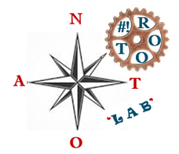

&nbsp;

# Antonin Moisan

### Cybersécurité · Linux · Open Source · Souveraineté · Apprendre · Partager

**« La ligne droite n'est pas toujours le chemin le plus court... ⛰️   
Parcours non linéaire, détermination tenace : chaque virage est un chapitre, mais le cap est devant ! »** 🧭

&nbsp;

---

## Bonjour !

Ingénieur Expert en **Cybersécurité** en alternance à la **Fondation Edith Seltzer** (acteur médico-social des Hautes-Alpes), en préparation du **Master Expert en Cybersécurité** avec LiveCampus. L'année passée : administrateur système & réseau en entreprise MSP (Isiscom).

Après **20 ans de métiers de terrain** — vigneron indépendant, maçon, cordiste, pisteur-secouriste en ski alpin — je me suis reconverti dans l'informatique. Ce parcours non linéaire est ma force : autonomie, sang-froid, sens du collectif et goût pour les réalisations abouties.

## Le cap

- 🐧 **Administration Linux** et architectures **open source**
- 🔐 **Sécurisation des infrastructures** : pare-feu, VPN, SIEM, durcissement, supervision
- 🇫🇷 **Souveraineté numérique** : maîtrise des SI, solutions libres
- ⚙️ **Automatisation** : Bash, PowerShell, Python, conteneurs
- 📚 **Partage de connaissances** : apprendre et aider à apprendre → [lab-anto.com](https://lab-anto.com)

## Boîte à outils

**Systèmes & virtualisation**

**Réseau & sécurité**

**Scripting & automatisation**

🌱 **En cours d'apprentissage** : Terraform, Kubernetes avancé, N8N — labs à venir !

## Projets & labs

| Projet | Description |
|---|---|
| 🎬 [**bonjour-systeme**](https://github.com/Antonin05-M/bonjour-systeme) | Script PowerShell : brief système animé et coloré dans le terminal — capteurs, jauges, applications, santé machine |
| 🐳 *Stacks Docker* | Environnements auto-hébergés et labos conteneurisés |
| 🏗️ *Labs Terraform* | Infrastructure as Code : réseau, VM, cloud |
| 🐍 *Applis Python* | Petits outils d'automatisation et d'admin sys/réseau |
| 🌐 *Projets admin sys & réseau* | Retours de missions et labos à découvrir sur [lab-anto.com](https://lab-anto.com) |

## En ce moment

- 🎓 Préparation du **Master Expert en Cybersécurité** (LiveCampus)
- 🏅 Titre **Administrateur d'Infrastructures Sécurisées** (RNCP Niveau 6) — jury passé, en attente du verdict officiel !
- 🏥 Construction de l'équipe Infrastructure à la Fondation Edith Seltzer
- ✍️ Alimentation de [lab-anto.com](https://lab-anto.com) et de ce GitHub

## Me retrouver

## Hors SI

Président du club **Briançon Escalade**, ski alpin, cordisme. La montagne me nourrit autant que le terminal — même exigence, même verticalité.

---

&nbsp;

Ⓒ 2026 — Apprendre et aider à apprendre. 🤝

